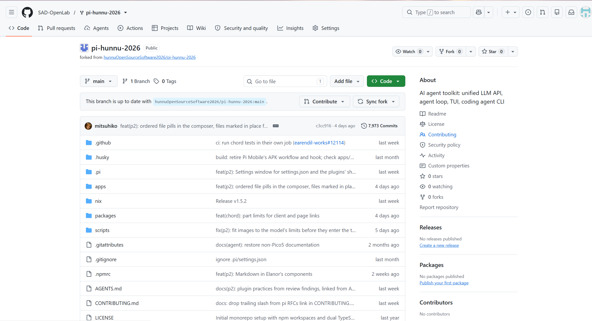
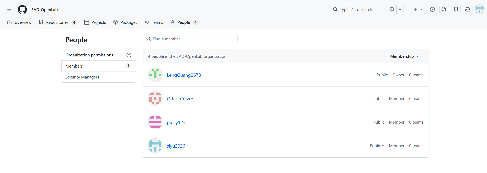
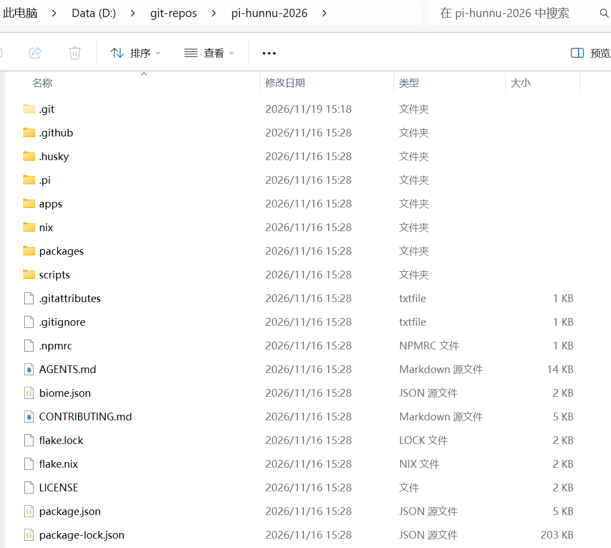
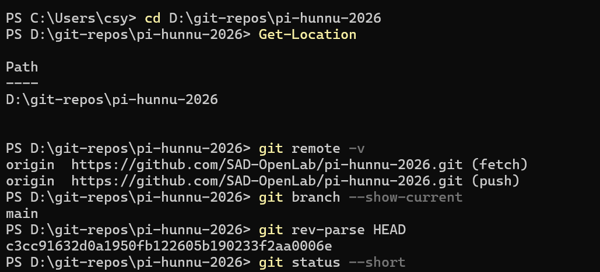
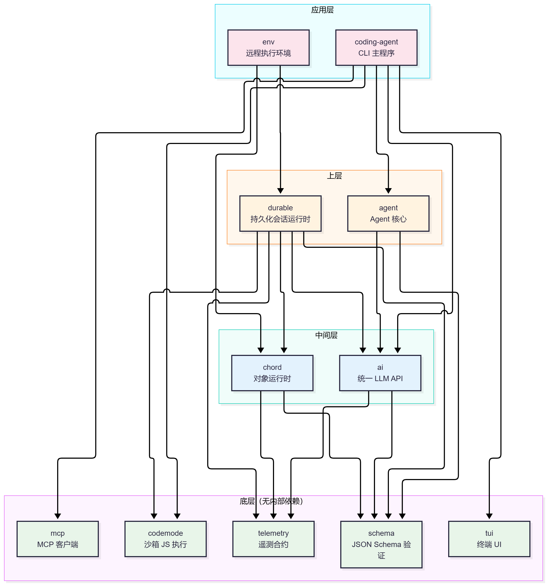

# 实践课2：小组组织建仓与 Pi Agent 源码分析

姓名：谌思雨

学号：202430224066

## 一、源码获取

### 1.1 小组组织仓库

- 个人作业地址：https://github.com/siyu2026/pi-practice-repo/blob/main/practice2/README.md
- 小组组织仓库：https://github.com/SAD-OpenLab/pi-hunnu-2026
- 实际clone地址：https://github.com/SAD-OpenLab/pi-hunnu-2026.git
- 本次提交编号：c3cc91632d0a1950fb122605b190233f2aa0006e

### 1.2 本地 clone 源码信息

**截图 S0：源码仓库信息**







> 说明：展示本地文件管理器下 `pi‑hunnu‑2026` 仓库根目录，能够看到 `packages` 文件夹、根目录package.json等，证明源码已经完整下载到本地磁盘。

---

### 1.3 版本确认

```powershell
# 以下命令在源码仓库根目录执行
Get-Location          # 显示当前目录
git remote -v         # 显示远端地址
git branch --show-current   # 显示当前分支
git rev-parse HEAD    # 显示完整提交编号
git status --short    # 显示工作区状态
```

**截图 S1：版本信息**



## 二、构建顺序与总览

Pi Agent 是一个 **npm monorepo**，根目录 `package.json` 中通过 `workspaces` 字段声明 `packages/*`。根目录 `npm run build` 脚本硬编码了 11 个模块的串行构建顺序：

```
telemetry → schema → chord → tui → codemode → mcp → ai → durable → env → agent → coding-agent
```

所有模块的 version 统一为 `1.5.2`，Node 引擎要求 `>=22.19.0`。

---

## 三、模块分析表

| 子文件夹       | 代码主要实现什么功能                                                                                                              | 本模块 build 执行什么、生成什么                                                                                                               | 直接依赖哪些内部模块                             | 依据文件或代码位置                                                           |
| -------------- | --------------------------------------------------------------------------------------------------------------------------------- | --------------------------------------------------------------------------------------------------------------------------------------------- | ------------------------------------------------ | ---------------------------------------------------------------------------- |
| `telemetry`    | 跨平台遥测追踪合约定义、类型化的 telemetry schema 工具、render 和 testing 子模块                                                  | `tsc -p tsconfig.build.json`，编译 TypeScript → `dist/` 目录（.js + .d.ts）                                                                   | **无**（最底层）                                 | `packages/telemetry/package.json`、`src/index.ts`                            |
| `schema`       | 自研 JSON Schema 验证器（drafts 2020-12 和 7），不使用 eval，编译为纯闭包                                                         | `tsc -p tsconfig.build.json` → `dist/`                                                                                                        | **无**（最底层）                                 | `packages/schema/package.json`、`src/index.ts`                               |
| `chord`        | 跨进程对象运行时：合约（contracts）、文档（documents）、状态存储、链接、带热重载的插件、HTTP、Worker、Web/TUI 客户端              | `tsc -p tsconfig.build.json` → `dist/`                                                                                                        | `schema`、`telemetry`                            | `packages/chord/package.json`、`docs/design.md`、`src/index.ts`              |
| `tui`          | 终端用户界面库，基于差量渲染（differential rendering）实现高效文本界面；含 Windows/macOS/Linux 三平台原生构建脚本                 | `tsc -p tsconfig.build.json` → `dist/`；可选 `build:native:*` 编译 C/ObjC 原生扩展                                                            | **无内部依赖**                                   | `packages/tui/package.json`、`native/win32/`                                 |
| `codemode`     | 沙箱化 JavaScript 执行环境（QuickJS/WASM），只能调用注入的工具；支持 Cloudflare Durable Objects 和 Worker 运行时                  | `tsc -p tsconfig.build.json` → `dist/`（多入口 exports）                                                                                      | **无内部依赖**                                   | `packages/codemode/package.json`、`src/index.ts`、`src/wasm.ts`              |
| `mcp`          | 独立的 Model Context Protocol 客户端，提供 OAuth 集成和 testing 子模块                                                            | `tsc -p tsconfig.build.json` → `dist/`                                                                                                        | **无内部依赖**                                   | `packages/mcp/package.json`、`src/index.ts`                                  |
| `ai`           | 统一 LLM API 层：自动模型发现、多 Provider 适配（Anthropic、OpenAI、Bedrock、Google Gemini、OpenRouter 等）、OAuth 认证、图像模型 | `npm run generate-models`（从 catalog 生成 `models.generated.ts`）→ `tsc -p tsconfig.build.json` → `dist/`，再复制 `providers/data`           | `schema`、`telemetry`                            | `packages/ai/package.json`、`catalog/generate.ts`、`src/models.generated.ts` |
| `durable`      | 持久化会话运行时：对话视图、任务调度、文档存储（JSONL/SQLite/IndexedDB/内存）、工具搜索、图像处理、codemode 运行时封装            | `tsc -p tsconfig.build.json` → `dist/`（多入口）                                                                                              | `chord`、`ai`、`codemode`、`schema`、`telemetry` | `packages/durable/package.json`、`src/index.ts`、`src/storage/`              |
| `env`          | 远程执行环境：一个通过 SSH 部署的小型 daemon，以及对应的 ExecutionEnv 客户端                                                      | `tsc -p tsconfig.build.json` → `dist/`；可选 `build:daemon`（Cargo/Rust 编译 daemon）                                                         | `chord`、`durable`                               | `packages/env/package.json`、`daemon/Cargo.toml`                             |
| `agent`        | 通用 Agent 核心：传输抽象、状态管理、附件支持                                                                                     | `tsc -p tsconfig.build.json` → `dist/`                                                                                                        | `ai`、`schema`                                   | `packages/agent/package.json`、`src/agent.ts`、`src/agent-loop.ts`           |
| `coding-agent` | **主程序（CLI 入口）**：集成 read/bash/edit/write 工具、会话管理、交互式 TUI 模式、RPC 模式、bundle 打包                          | `tsc -p tsconfig.build.json` + 资源复制 → 再由 `build-coding-agent-bundle.mjs` 打包为单一 bundle；可选 `build:binary` 用 bun 编译为独立二进制 | `agent`、`ai`、`codemode`、`mcp`、`tui`          | `packages/coding-agent/package.json`、`src/cli.ts`、`src/main.ts`            |

---

## 四、模块层级与依赖关系图

### 4.1 层级划分依据

根据模块在依赖图中的"入度"（被多少上层模块依赖）和"出度"（依赖多少内部模块），划分为四层：

- **底层（leaf）**：出度为 0，不依赖任何内部模块，是整个体系的基石
- **中间层**：依赖底层模块，向上提供运行时和 AI 能力
- **上层**：组合中间层能力，提供对话运行时和 Agent 核心
- **应用层**：依赖多个上层/中间层模块，是 CLI 主程序和远程环境的实际交付物

### 4.2 Mermaid 依赖关系图

箭头方向：**使用方 → 被依赖方**（箭头指向被依赖的模块）



---

## 五、构建与依赖关系回答

### 问题 1：根目录与子模块中的 `npm run build` 分别读取什么配置、执行什么工作？

**根目录 `npm run build`**：

- 读取根目录 `package.json` 中的 `scripts.build` 字段
- 该脚本是一串硬编码的 `cd packages/<模块> && npm run build &&` 串联命令，按固定顺序依次进入 11 个子模块并执行它们各自的 build 脚本
- 不使用 lerna/turbo/nx 等 monorepo 构建工具，而是手动串行，依赖顺序写死在脚本里

**各子模块 `npm run build`**：

- 绝大多数模块：`tsc -p tsconfig.build.json`，即调用 TypeScript 编译器，读取本模块的 `tsconfig.build.json` 配置（通常设定 `outDir: dist`、`declaration: true`、`module: nodenext`），将 `src/` 下的 `.ts` 文件编译为 `dist/` 下的 `.js` 和 `.d.ts`
- **ai 模块特殊**：`npm run generate-models && npm run build:offline`。先生成模型数据（`node catalog/generate.ts --strict`），再做 check + tsc + 数据复制。这是因为 AI Provider 信息中模型列表是代码生成的，不是手写的
- **coding-agent 模块特殊**：`npm run build:unbundled && node ../../scripts/build-coding-agent-bundle.mjs`。除了 tsc 编译，还需要一个额外脚本把多个包的产物 bundle 在一起（产出单一可执行的 `dist/bundle/cli.js`）
- **env 模块**：额外有 `build:daemon`（Rust/Cargo），构建远程执行用的 Rust daemon 二进制

### 问题 2：构建顺序和模块依赖有什么关系？相邻构建的模块是否一定互相依赖？

**构建顺序 = 拓扑排序的一种合法结果**。根目录的 11 个模块按依赖关系可以排成一个 DAG，脚本中的顺序就是这个 DAG 的一个拓扑序。具体来说：

```
底层（入度 0）:   telemetry, schema, tui, codemode, mcp  ← 互相独立，放在最前
中间层:           chord, ai                              ← 依赖底层的 telemetry/schema
上层:             durable, agent                         ← 依赖中间层
应用层:           env, coding-agent                      ← 依赖上层和中间层
```

**相邻模块不一定互相依赖**。几个例子：

- `telemetry` 和 `schema` 相邻（1、2 位），但它们之间**完全没有依赖**，互不 import
- `codemode` 和 `mcp` 相邻（5、6 位），也互相独立
- `tui` 排在第 4 位，只有 `coding-agent` 依赖它，但 coding-agent 在最后（第 11 位），中间隔了 7 个模块

顺序的实际约束来自：**后面的模块依赖前面某个模块时，那个被依赖的模块必须先构建完**。不要求"紧挨着构建"。脚本选择线性顺序是因为这是最简单、最可预测的执行方式，避免并发构建带来的复杂性。

### 问题 3：选择一条涉及至少三个模块的依赖路径，说明这些模块如何分工

**依赖路径：`coding-agent → durable → chord → telemetry`**

这条路径覆盖了应用层 → 上层 → 中间层 → 底层四个层级，每个模块的职责清晰分离：

#### Layer 1: `telemetry`（最底层）

提供**遥测追踪合约和类型化 schema**。定义了 Trace、Span、Event 等数据结构，以及一个最小化的 tracing API。这个模块本身不做任何"业务"，只保证上层模块可以统一、类型安全地记录追踪数据。它的产物可以被任何模块 import，不会被具体的传输方式（文件、网络、SQLite）绑定。

#### Layer 2: `chord`（中间层）

在 telemetry 之上构建**跨进程对象运行时**。它引入了几个关键概念：

- **Delta**：不可变 JSON 状态的差量表示（类似 CRDT），让多个进程可以对同一份文档做增量修改并合并
- **Context**：每个操作携带的执行上下文，其中包含 telemetry 实例和文件系统访问能力
- **Storage**：基于 Delta 的持久化层，有内存、JSONL、SQLite 等后端

chord 还提供插件系统、HTTP server、Worker 管理等能力。它的定位是一个**通用的、可嵌入的应用框架**，本身不知道什么是"对话"、什么是"Agent"——它只知道"有状态的对象需要被追踪和持久化"。

#### Layer 3: `durable`（上层）

在 chord 之上构建**持久化会话运行时**。这里开始引入 Agent 相关的具体概念：

- **Conversation**：对话对象，用 chord 的 Delta 来追踪消息历史的增量变化
- **Task**：可持久化的任务队列，即使进程崩溃恢复后仍能继续执行
- **Codemode 集成**：把 codemode 的沙箱执行器封装为工具，可以在对话中调用
- **AI 集成**：把 ai 模块的 Provider 封装为消息生成器

durable 的职责是**把一次 Agent 会话变成一个可恢复、可持久化的状态机**。它组合 chord 的存储能力和 ai 的模型能力，暴露给上层一个简洁的 API：给我一个提示词，我返回模型回复，并确保中间状态安全落地。

#### Layer 4: `coding-agent`（应用层）

最终的**CLI 程序**。它把 durable 的会话运行时、agent 的 Agent 循环、tui 的终端界面、mcp 的协议支持全部组装起来，提供用户可见的产品：

- 交互式终端界面（TUI 模式）
- RPC 服务模式（让 Trae 等 IDE 可以远程调用）
- `pi install` 包管理、`/login` 认证、插件系统

coding-agent 本身几乎不写"核心逻辑"，它是一个**组装器**：把下层已经实现好的能力（持久化、模型调用、沙箱执行、终端渲染）用正确的方式拼在一起，加上命令行入口和用户配置。

#### 分工总结

| 层     | 模块         | 一句话职责              | 不知道什么                              |
| ------ | ------------ | ----------------------- | --------------------------------------- |
| 底层   | telemetry    | 记录 trace 和 span      | 不知道什么是对话、Agent                 |
| 中间层 | chord        | 跨进程状态追踪 + 存储   | 不知道什么是 LLM、什么是编码任务        |
| 上层   | durable      | 持久化 Agent 会话运行时 | 不知道怎么渲染终端 UI、怎么解析用户命令 |
| 应用层 | coding-agent | CLI 主程序，组装一切    | —                                       |

这种分层使得：如果未来要把 Pi Agent 移植到浏览器或服务器端，只需要替换 coding-agent 和 durable 的一小部分，底层的 chord/telemetry/schema 完全可以复用。

---

## 六、个人重点分析的模块

本次重点分析了 **`chord`** 和 **`durable`** 两个模块，原因是它们处在依赖图的"枢纽"位置——既被上层依赖，又依赖多个底层模块，理解它们就能串联起整个架构。

**chord 模块亮点**：`delta/` 目录实现了一套基于不可变 JSON 的差量合并算法（类似 OT/CRDT），`docs/slice-*.md` 系列文档把功能切成了 13 个垂直 slice 逐个实现，这在开源项目的设计文档中非常少见且值得学习。

**durable 模块亮点**：`src/storage/` 下提供了四种存储后端（memory / JSONL / SQLite / IndexedDB），抽象接口统一，这使得同一份对话数据既能跑在 Node.js 服务器上（用 SQLite），也能跑在浏览器里（用 IndexedDB），还能跑在 Cloudflare Worker 上（用 Durable Objects 的存储）。
