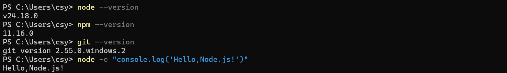
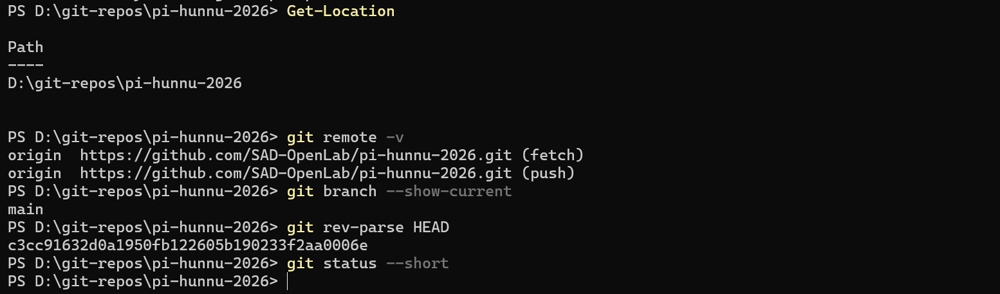
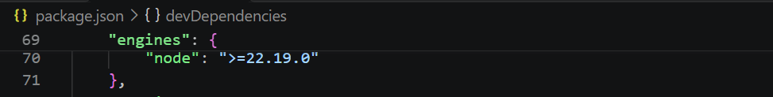
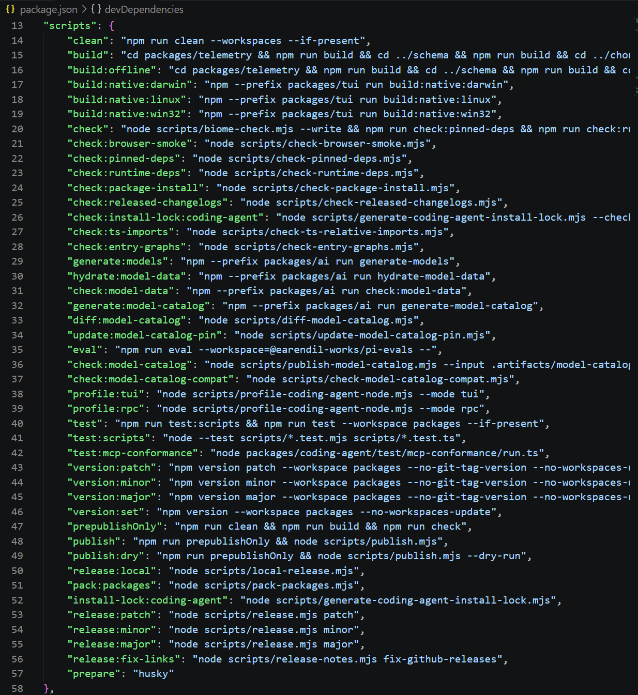
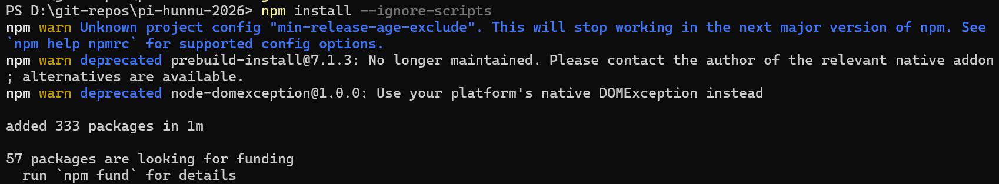
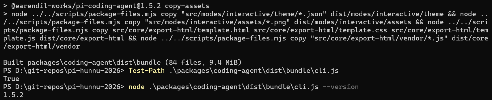
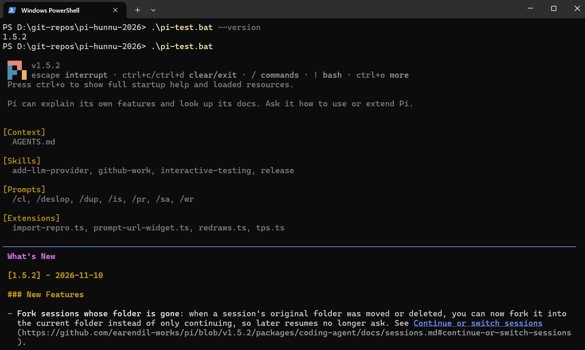
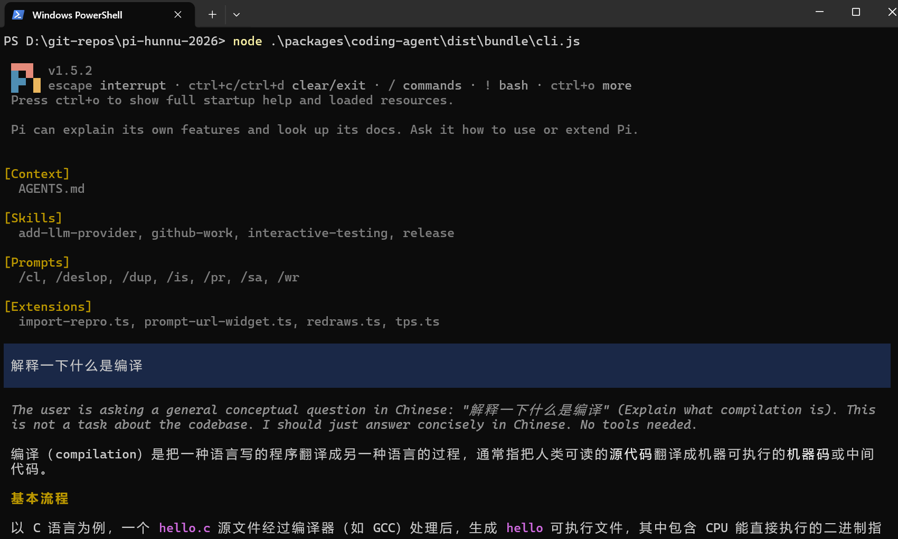

# 实践课3：Pi Agent 源码安装与编译

姓名：谌思雨

学号：202430224066

- 个人作业地址：https://github.com/siyu2026/pi-practice-repo/blob/main/practice3/README.md
- 小组组织仓库：https://github.com/SAD-OpenLab/pi-hunnu-2026
- 源码提交编号：c3cc91632d0a1950fb122605b190233f2aa0006e
- Node.js 版本：24.18.0
- npm 版本：11.16.0

## 一、实验准备：检查开发工具环境

### 1. 检查现有环境

在 PowerShell 中执行：

```powershell
node --version
npm --version
git --version
```

**截图 S1：** 三条命令的输出，确认实际版本。



### 2. Node.js 版本确认

根项目 `package.json` 的 `engines` 字段声明：

```json
"engines": {
  "node": ">=22.19.0"
}
```

本次实验建议使用 **Node.js 24 LTS**，避免 `EBADENGINE` 警告。

---

## 二、下载课程仓库源码

执行过的命令：

```powershell
git clone --branch main https://github.com/<自己小组组织>/pi-hunnu-2026.git
cd pi-hunnu-2026
```

确认源码来源和版本：

```powershell
Get-Location
git remote -v
git branch --show-current
git rev-parse HEAD
git status --short
```

**截图 S2：** 上述五条命令的终端输出。



---

## 三、阅读配置，确认安装与编译依据

查看以下文件：

| 文件或目录 | 观察内容 |
|---|---|
| `package.json` | `engines`、`workspaces`、`scripts`、`devDependencies` |
| `package-lock.json` | 锁定依赖版本 |
| `packages/` | 多包管理 |
| `packages/coding-agent/package.json` | CLI 构建脚本和 `bin` 入口 |

**截图 S3：** 根 `package.json` 的 `engines.node` 和 `scripts.build` 定义。




**回答问题：**

**Q1：Node.js 版本要求在哪里？**

在根目录 `package.json` 的 `engines.node` 字段中声明。本项目写的是 `>=22.19.0`，含义是：

- `engines` 是 npm 的一个标准字段，用来声明当前包对运行环境的版本约束
- 根 `package.json` 的 `engines` 对整个 workspaces（即 `packages/` 下所有子包）都生效
- `>=22.19.0` 表示 Node.js 版本必须大于等于 22.19.0，补丁版本不限
- 但要注意：某些子依赖可能有更高的版本要求，比如本次安装中出现的 `EBADENGINE` 警告，就是某个依赖包声明了 `>=23.6.0`，此时即使满足根项目要求也会触发警告

可以用 `npm ls engines` 或直接打开根 `package.json` 查看这个字段的具体内容。

**Q2：`npm run build` 实际从哪里读取命令？**

从根目录 `package.json` 的 `scripts.build` 字段读取。具体执行链路是：

1. 在终端输入 `npm run build` → npm 找到当前目录下的 `package.json`
2. 读取其中的 `scripts.build` 字段值（一条 shell 命令字符串）
3. 在子 shell 中执行这条命令

本项目的 `scripts.build` 实际内容是一串用 `&&` 连接的 `npm --workspace <包名> run build` 命令，意思是：**依次进入每个子包，执行该子包自己的 `npm run build`**。`&&` 保证了前一个子包构建成功后才会继续下一个，一旦某个子包失败，整个构建就停止。

这也解释了为什么必须在**根目录**执行 `npm run build`——因为只有根目录的 `package.json` 定义了完整的构建顺序，子包的 `package.json` 只定义各自包内部的构建逻辑。

---

## 四、安装项目依赖

在仓库根目录执行：

```powershell
npm install --ignore-scripts
```

该命令完成的工作：
- 根据 `package.json` 和 `package-lock.json` 解析、下载并安装依赖
- 建立 `node_modules`，关联 workspaces 中的本地包
- `--ignore-scripts` 跳过安装阶段的 `postinstall` / `prepare` 脚本

**截图 S4：** 安装结束的输出（包含汇总信息和 vulnerabilities 审计结果）。



**遇到的警告记录（如无则写"无"）：**

| 警告类型 | 内容 | 是否影响构建 |
|---|---|---|
| EBADENGINE | （Node.js 版本不匹配时出现） | 建议解决 |
| deprecated | 依赖包弃用提示 | 不影响构建 |
| vulnerabilities | 审计结果 | 不直接影响构建，不要随便 `--force` |

---

## 五、本地编译与构建产物验证

### 1. 执行构建

```powershell
npm run build
```

首次构建会联网获取模型目录数据（**不是下载大模型权重**）。

### 2. 检查构建产物

```powershell
Test-Path .\packages\coding-agent\dist\bundle\cli.js
node .\packages\coding-agent\dist\bundle\cli.js --version
```

第一条应输出 `True`，第二条应输出版本号。

**截图 S5：** 需包含以下全部内容：
- `npm run build` 完整结束的最后一段输出 + 退出码 `0`
- `Test-Path cli.js` 输出 `True`
- `node cli.js --version` 输出版本号



---

## 六、启动本地源码版本并完成一次会话

### 1. 验证源码入口

```powershell
.\pi-test.bat --version
```

### 2. 启动交互界面并发送消息

```powershell
.\pi-test.bat
```

发送一个简单问题，例如：

```
请用一句话说明源码和编译产物的区别。只回答问题，不修改文件。
```

**截图 S6：** 需包含：
- `.\pi-test.bat` 启动命令
- Pi 交互界面
- 自己的提示词
- 模型的回复





**回答问题：**

**Q1：本次如何确保运行的是本地源码？**

使用 `.\pi-test.bat` 而非全局 `pi` 命令。具体区别：

- `pi` → 运行的是第一次实践课安装的**全局版本**（来自 `npm install -g`，产物在全局 node_modules 里）
- `.\pi-test.bat` → 运行的是本次下载的**本地源码**。`.bat` 文件内部调用同目录下的 `.ps1` 脚本，由 Node.js 直接加载 `packages/coding-agent/src/cli.ts` 并执行，**完全跳过了 build 过程**

两者共用同一用户配置目录 `~/.pi/agent`，所以登录凭据是复用的，这不代表运行的是全局版本。区分的关键就是命令：`pi` vs `.\pi-test.bat`。

**Q2：源码入口与 `dist/bundle/cli.js` 入口分别适合什么场景？**

| 入口 | 本质 | 适用场景 |
|---|---|---|
| `.\pi-test.bat` | 直接运行 `src/cli.ts` 源码，跳过编译 | 开发调试——改了源码直接跑，不用重新 `npm run build` |
| `node dist/bundle/cli.js` | 运行 `npm run build` 产出的**编译后产物**（已打包压缩） | 验证构建是否正确——确认 build 没有把源码搞坏；以及最终交付前的测试 |

简单说：**开发用前者，验构建用后者**。

---

## 七、遇到的困难与解决过程

**问题1：npm install出现deprecated弃用警告**

现象：执行`npm install --ignore-scripts`结束后，控制台输出多条`deprecated`弃用警告与配置提示警告，无`ERR!`类致命报错。

原因：部分第三方依赖包已经停止维护，属于正常提示。

解决：根据作业文档说明，弃用警告不会影响安装与编译，禁止执行`npm audit fix --force`，直接忽略警告，继续后续构建，`npm run build`可以正常完成。

---

**问题2：运行pi‑test.bat出现目录信任弹窗**

现象：执行`.\pi-test.bat`启动本地源码版本，弹出项目信任选择对话框，如果选择不信任，Pi会限制项目相关能力，无法完整使用交互会话。

原因：Pi内置项目安全校验机制，需要确认是否信任当前源码目录。

解决：选择`Trust(this session only)`，仅本次会话信任目录，关闭终端信任自动失效；确认后成功进入Pi交互界面，可正常进行对话。